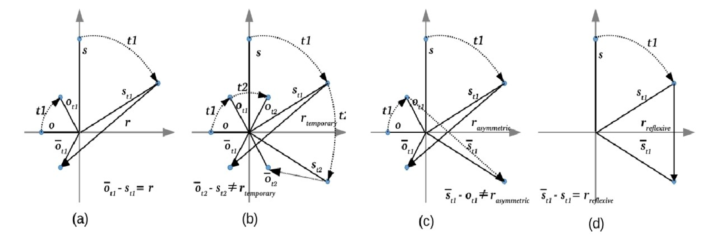
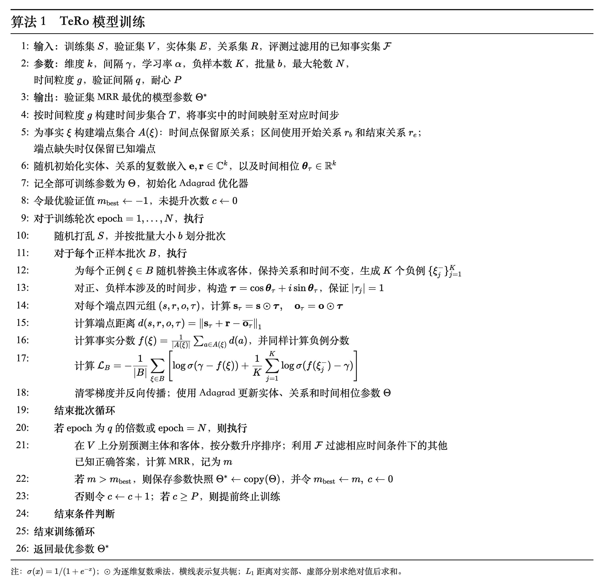

# [2020] TeRo

## 核心方法

### 1. 用旋转得到实体在某个时间的状态

TeRo 为每个时间步学习一个旋转向量 $\boldsymbol{\tau}$：

$$
\mathbf{s}_t = \mathbf{s} \odot \boldsymbol{\tau},
\qquad
\mathbf{o}_t = \mathbf{o} \odot \boldsymbol{\tau},
\qquad
|\tau_j| = 1
$$

这里，$\mathbf{s},\mathbf{o}$ 是主体、客体的基础表示；$\odot$ 表示逐个维度相乘。同一时间的旋转向量在实体之间共享，但各维可以旋转不同角度。

### 2. 用关系平移，衡量事实是否成立

模型希望一个真实事实满足：

$$
\mathbf{s}_t + \mathbf{r} \approx \overline{\mathbf{o}_t}
$$

对应的距离分数为：

$$
f(s,r,o,t) = \left\lVert \mathbf{s}_t + \mathbf{r} - \overline{\mathbf{o}_t} \right\rVert
$$

$\mathbf r$ 是关系向量；上横线表示复共轭，即把 $a+bi$ 变成 $a-bi$，几何上相当于沿实轴翻转。距离越小，模型认为事实越合理。



- **(a) 基本关系**：主体旋转后的点 $s_t$ 加上关系向量 $r$，到达客体旋转后再取共轭的位置 $\overline{o_t}$。
- **(b) 时间变化**：换一个时间，原来成立的关系可以不再成立。
- **(c) 方向差异**：“甲是乙的父母”成立，不要求“乙是甲的父母”也成立。
- **(d) 自反事实**：实体可以与自身存在关系，关系向量不必一律变成零。

### 3. 把时间区间拆成“开始”和“结束”

TeRo 为“任职于”学习两个关系表示：开始关系 $r_b$ 和结束关系 $r_e$，分别计算两端的距离，再取平均：

$$
f_{\text{区间}}
= \frac{1}{2}\left[
\left\lVert \mathbf{s}_{t_b} + \mathbf r_b - \overline{\mathbf{o}_{t_b}} \right\rVert
+ \left\lVert \mathbf{s}_{t_e} + \mathbf r_e - \overline{\mathbf{o}_{t_e}} \right\rVert
\right]
$$

只知道开始或结束时间时，就使用已知的一端。相比把区间内每个时间点都展开成训练样本，这种处理节省样本和计算。

## 伪代码



## 代码

### 1. 初始化实体、关系和时间参数

```python
self.emb_E_real = torch.nn.Embedding(
    self.kg.n_entity, self.embedding_dim, padding_idx=0)
self.emb_E_img = torch.nn.Embedding(
    self.kg.n_entity, self.embedding_dim, padding_idx=0)

self.emb_R_real = torch.nn.Embedding(
    self.kg.n_relation * 2, self.embedding_dim, padding_idx=0)
self.emb_R_img = torch.nn.Embedding(
    self.kg.n_relation * 2, self.embedding_dim, padding_idx=0)

self.emb_Time = torch.nn.Embedding(
    n_day, self.embedding_dim, padding_idx=0)
```

### 2. 构造时间旋转

```python
d_img = torch.sin(
    self.emb_Time(d_i).view(-1, self.embedding_dim))

d_real = torch.cos(
    self.emb_Time(d_i).view(-1, self.embedding_dim))
```

### 3. 计算实体的时间相关表示

```python
h_real = (
    self.emb_E_real(h_i).view(-1, self.embedding_dim) * d_real
    - self.emb_E_img(h_i).view(-1, self.embedding_dim) * d_img
)

h_img = (
    self.emb_E_real(h_i).view(-1, self.embedding_dim) * d_img
    + self.emb_E_img(h_i).view(-1, self.embedding_dim) * d_real
)
```
