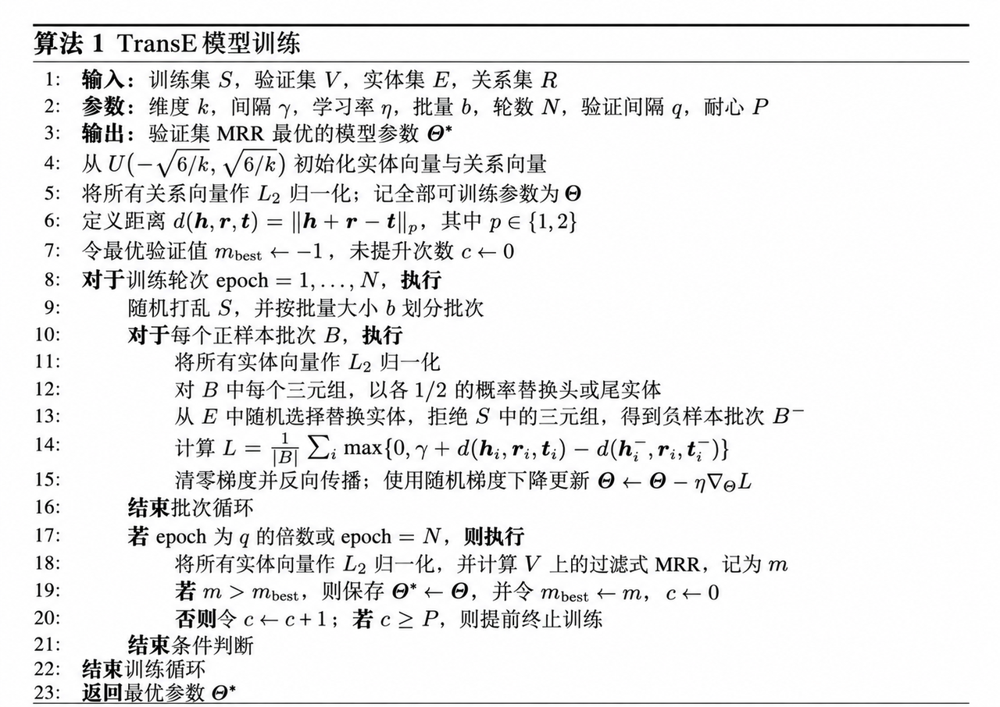

# TransE

## 背景

如何把知识图谱中的实体和关系表示成低维向量，并利用这些向量预测知识图谱中缺失的事实。

## 思路

对于一个正确三元组 $(h,r,t)$，TransE 希望：

$$
\mathbf h + \mathbf r \approx \mathbf t
$$

## 评分函数

TransE 使用下面的距离衡量三元组是否可信：

$$
f_r(h,t) = \lVert \mathbf h + \mathbf r - \mathbf t \rVert_1
$$

或者：

$$
f_r(h,t) = \lVert \mathbf h + \mathbf r - \mathbf t \rVert_2
$$

含义是：

- 分数越小，三元组越可信；
- 分数越大，三元组越不可信。

## 它是怎么训练的

训练数据中只有知识图谱已经存在的正确三元组，例如：

$$
(\text{Paris},\text{capitalOf},\text{France})
$$

为了让模型知道什么是错误事实，TransE 会生成“破坏三元组”，即随机替换头实体或尾实体：

$$
(\text{London},\text{capitalOf},\text{France})
$$

或者：

$$
(\text{Paris},\text{capitalOf},\text{Germany})
$$

训练目标是让正确三元组的距离，比错误三元组至少小一个间隔 $\gamma$：

$$
L = \sum_{(h,r,t)} \sum_{(h',r,t')} \left[ \gamma + f_r(h,t) - f_r(h',t') \right]_+
$$

## 缺点

假设 $(h,r,t_1)$ 和 $(h,r,t_2)$ 都成立，那么模型同时要求：

$$
\mathbf h + \mathbf r \approx \mathbf t_1
$$

以及：

$$
\mathbf h + \mathbf r \approx \mathbf t_2
$$

这会迫使：

$$
\mathbf t_1 \approx \mathbf t_2
$$

因此，TransE 比较适合一对一关系，但处理以下关系时容易出现问题：

- 一对多，例如一个国家拥有多个城市；
- 多对一，例如很多城市位于同一个国家；
- 多对多，例如人与语言之间的关系；
- 对称关系；
- 传递关系；
- 一个实体在同一关系下对应多个语义差异很大的实体。

## 训练伪代码

